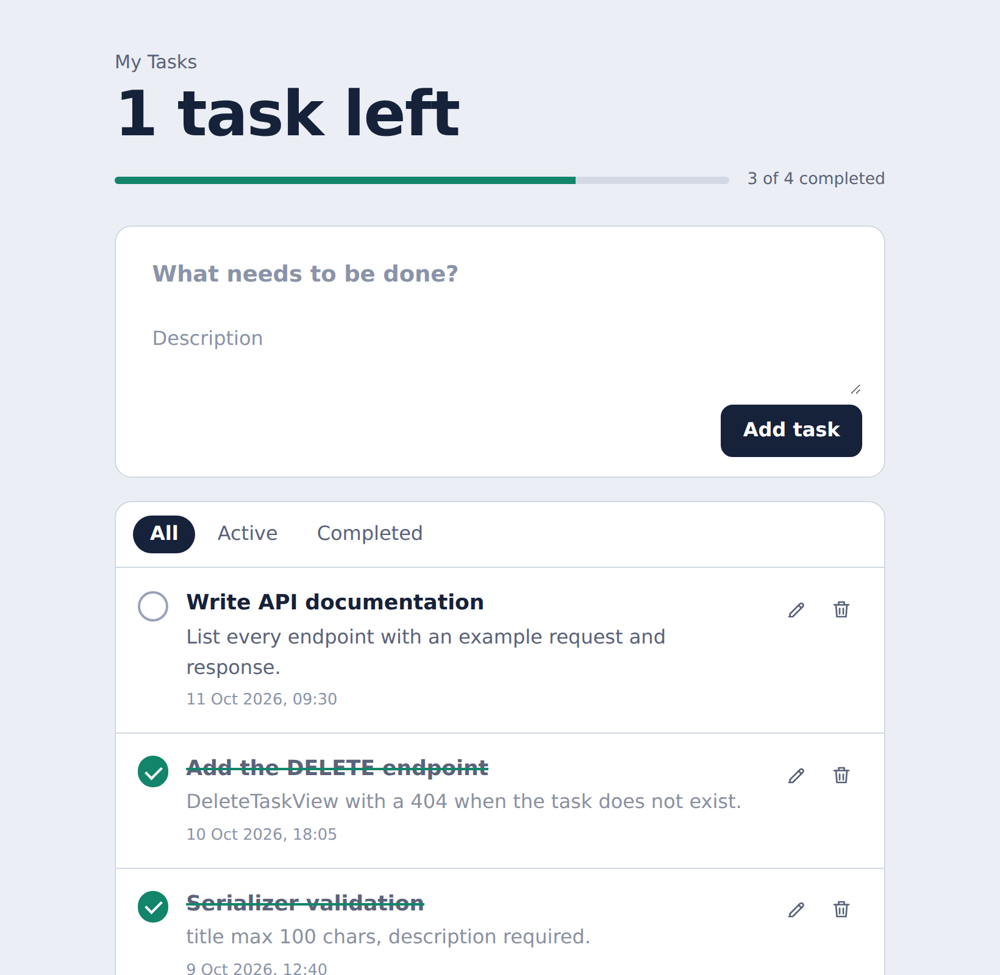

<div align="center">

# Todo API

**A Django REST Framework practice project with a simple single-page frontend**

[English](#english) · [فارسی](#فارسی)



</div>

---

<a name="english"></a>

## English

### About

This is a small **practice project for learning REST APIs and Django REST Framework (DRF)**.
The backend is a simple Todo API built with class-based `APIView`s, a `ModelSerializer`, and SQLite.

> **Note:** The frontend (`main/templates/index.html`) is a single HTML file with plain HTML, CSS and JavaScript (no frameworks). It was **generated by [Claude](https://claude.ai)** (an AI assistant by Anthropic) so I could focus on learning the API side.

### Features

- List, add, edit, complete and delete tasks through a JSON API
- Input validation with DRF serializers (title max 100 characters, description required)
- Simple frontend served directly by Django at `/` (no Node.js, no build step, no CORS setup)
- Filters (All / Active / Completed), progress bar, and a custom delete-confirmation dialog

### Tech stack

- Python 3, Django, Django REST Framework
- SQLite
- Plain HTML / CSS / JavaScript (`fetch`)

### Getting started

```bash
# 1. Clone the repository
git clone <your-repo-url>
cd <your-repo-folder>

# 2. Create and activate a virtual environment
python -m venv .venv
# Windows (PowerShell):
.venv\Scripts\Activate.ps1
# macOS / Linux:
source .venv/bin/activate

# 3. Install dependencies
pip install -r requirements.txt

# 4. Create the database tables
python manage.py migrate

# 5. Run the server
python manage.py runserver
```

Open **http://127.0.0.1:8000/** in your browser.

### API reference

Base URL: `http://127.0.0.1:8000/api`

| Method   | Endpoint            | Description                                  | Success |
| -------- | ------------------- | -------------------------------------------- | ------- |
| `GET`    | `/tasks`            | List all tasks                               | `200`   |
| `POST`   | `/add-task`         | Create a task                                | `201`   |
| `PUT`    | `/update-task/<id>` | Update a task (partial: send only changed fields) | `200`   |
| `DELETE` | `/delete-task/<id>` | Delete a task                                | `200`   |

Errors: `400` for validation problems (DRF field errors), `404` with `{"error": "Task not found"}` when the id does not exist.

**Task object**

```json
{
  "id": 1,
  "title": "Learn DRF",
  "description": "Class-based views and serializers",
  "completed": false,
  "created_at": "2026-10-11T09:30:00Z",
  "updated_at": "2026-10-11T09:30:00Z"
}
```

**Examples**

```bash
# List
curl http://127.0.0.1:8000/api/tasks

# Create
curl -X POST http://127.0.0.1:8000/api/add-task \
  -H "Content-Type: application/json" \
  -d '{"title": "Learn DRF", "description": "Serializers and views"}'

# Mark as completed
curl -X PUT http://127.0.0.1:8000/api/update-task/1 \
  -H "Content-Type: application/json" \
  -d '{"completed": true}'

# Delete
curl -X DELETE http://127.0.0.1:8000/api/delete-task/1
```

> `add-task` and `update-task` return only a message (e.g. `{"message": "Task added successfully"}`), not the task object, so the frontend reloads the list after each change.

### Project structure

```
.
├── manage.py
├── requirements.txt
├── Todo/                  # project settings and root urls
├── main/
│   ├── models.py          # TaskModel
│   ├── serializers.py     # TaskSerializer
│   ├── views.py           # TaskView, AddTaskView, UpdateTaskView, DeleteTaskView
│   ├── urls.py            # /api/... routes
│   └── templates/
│       └── index.html     # frontend (generated by Claude)
└── image/                  # README screenshot
```

---

<a name="فارسی"></a>

<div dir="rtl">

## فارسی

### درباره‌ی پروژه

این یک **پروژه‌ی تمرینی برای یادگیری API و Django REST Framework (DRF)** است.
بک‌اند یک API ساده برای مدیریت کارها (Todo) است که با `APIView`های کلاس‌محور، `ModelSerializer` و SQLite نوشته شده.

> **توجه:** فرانت‌اند (`main/templates/index.html`) یک فایل HTML ساده با HTML، CSS و JavaScript خالص است (بدون فریم‌ورک) و توسط **[Claude](https://claude.ai)** (دستیار هوش مصنوعی شرکت Anthropic) ساخته شده تا بتوانم روی بخش API تمرکز کنم.

### امکانات

- نمایش، افزودن، ویرایش، تکمیل و حذف کارها از طریق API با فرمت JSON
- اعتبارسنجی ورودی با serializerهای DRF (عنوان حداکثر ۱۰۰ کاراکتر، توضیحات اجباری)
- فرانت ساده که مستقیم توسط Django روی `/` سرو می‌شود (بدون Node.js، بدون build و بدون نیاز به تنظیم CORS)
- فیلتر (همه / فعال / انجام‌شده)، نوار پیشرفت و پنجره‌ی تایید حذف اختصاصی

### فناوری‌ها

- Python 3، Django و Django REST Framework
- SQLite
- HTML / CSS / JavaScript ساده (با `fetch`)

### راه‌اندازی

</div>

```bash
# 1. کلون کردن پروژه
git clone <your-repo-url>
cd <your-repo-folder>

# 2. ساخت و فعال‌سازی محیط مجازی
python -m venv .venv
# ویندوز (PowerShell):
.venv\Scripts\Activate.ps1
# مک / لینوکس:
source .venv/bin/activate

# 3. نصب پیش‌نیازها
pip install -r requirements.txt

# 4. ساخت جدول‌های دیتابیس
python manage.py migrate

# 5. اجرای سرور
python manage.py runserver
```

<div dir="rtl">

بعد آدرس **http://127.0.0.1:8000/** را در مرورگر باز کنید.

### مستندات API

آدرس پایه: `http://127.0.0.1:8000/api`

</div>

| Method   | Endpoint            | توضیح                                         | موفقیت |
| -------- | ------------------- | --------------------------------------------- | ------ |
| `GET`    | `/tasks`            | دریافت همه‌ی کارها                            | `200`  |
| `POST`   | `/add-task`         | ساخت کار جدید                                 | `201`  |
| `PUT`    | `/update-task/<id>` | ویرایش کار (جزئی: فقط فیلدهای تغییرکرده)      | `200`  |
| `DELETE` | `/delete-task/<id>` | حذف کار                                       | `200`  |

<div dir="rtl">

خطاها: کد `400` برای خطای اعتبارسنجی (خطای فیلدهای DRF) و کد `404` همراه با `{"error": "Task not found"}` وقتی id وجود نداشته باشد.

**نمونه‌ی ساختار یک کار**

</div>

```json
{
  "id": 1,
  "title": "Learn DRF",
  "description": "Class-based views and serializers",
  "completed": false,
  "created_at": "2026-10-11T09:30:00Z",
  "updated_at": "2026-10-11T09:30:00Z"
}
```

<div dir="rtl">

**نمونه درخواست‌ها**

</div>

```bash
# دریافت لیست
curl http://127.0.0.1:8000/api/tasks

# ساخت کار
curl -X POST http://127.0.0.1:8000/api/add-task \
  -H "Content-Type: application/json" \
  -d '{"title": "Learn DRF", "description": "Serializers and views"}'

# علامت‌زدن به‌عنوان انجام‌شده
curl -X PUT http://127.0.0.1:8000/api/update-task/1 \
  -H "Content-Type: application/json" \
  -d '{"completed": true}'

# حذف
curl -X DELETE http://127.0.0.1:8000/api/delete-task/1
```

<div dir="rtl">

> `add-task` و `update-task` فقط یک پیام برمی‌گردانند (مثلاً `{"message": "Task added successfully"}`) و خود آبجکت کار را برنمی‌گردانند؛ برای همین فرانت بعد از هر تغییر لیست را دوباره دریافت می‌کند.

### ساختار پروژه

</div>

```
.
├── manage.py
├── requirements.txt
├── Todo/                  # تنظیمات پروژه و urlهای اصلی
├── main/
│   ├── models.py          # TaskModel
│   ├── serializers.py     # TaskSerializer
│   ├── views.py           # TaskView, AddTaskView, UpdateTaskView, DeleteTaskView
│   ├── urls.py            # مسیرهای /api/...
│   └── templates/
│       └── index.html     # فرانت (ساخته‌شده توسط Claude)
└── image/                  # تصویر README
```
